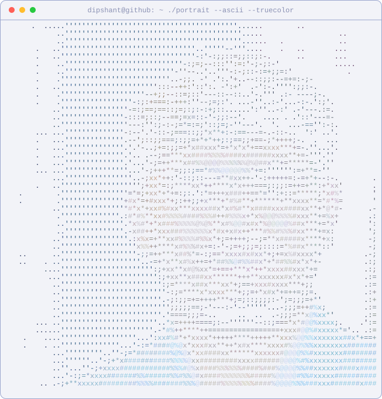
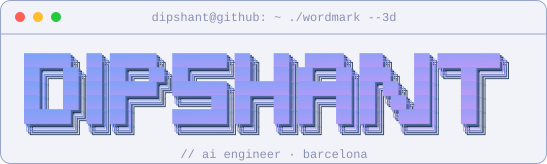
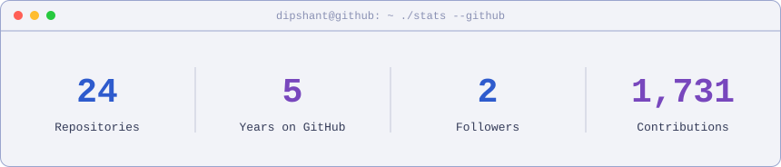
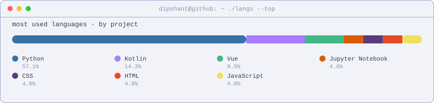
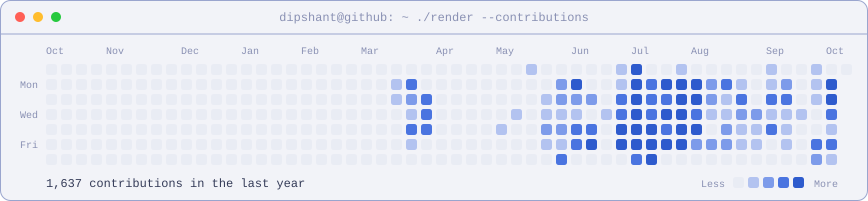
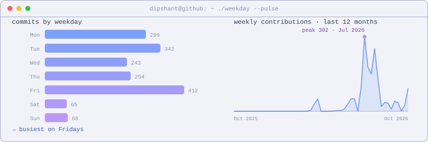

<!-- ============================================================
     GENERATED FILE — do not edit README.md directly.
     Edit templates/README.tpl.md, then run:  python scripts/build_readme.py
     Theme: change ACTIVE_THEME in scripts/theme.py (one line),
     rerun the render scripts + build_readme.py, commit.
     Daily refresh: .github/workflows/update-profile-art.yml
     ============================================================ -->
<div align="center">


<table>
<tr>
<td valign="top"></td>
<td valign="top"></td>
</tr>
</table>

</div>

## `dipshant@github:~$ whoami`

```text
Dipshant Paudel, AI Engineer @ Futurity Systems (Barcelona)
I take AI products from spec to monitored production: LLM apps, voice AI,
data pipelines and the servers they run on. BSc CS student @ Harbour.Space.
Everything on this page regenerates itself daily via GitHub Actions.
```

## `dipshant@github:~$ ls ./built-at-work`

<sub>Company repos are private, so here is what they do instead of links.</sub>

| | Project | What it does | Result |
|:-:|---|---|---|
| 🎙️ | **Voice AI** | Real-time voice assistant: speech-to-text → LLM → text-to-speech, fully self-hosted on a GPU server | 32 languages · first audio in ~2 s · replaced ElevenLabs on our persona pages |
| 📊 | **MarketSizer** | Sizes any market from published web data and backs every figure with a verbatim source quote | 24 / 26 test markets right · zero made-up figures · 4.4× faster extraction |
| 💸 | **Freedbase** | Crunchbase alternative built on free public news and filings; every value is checked against its source | Live since Sep 2026 · 1,700+ automated tests |
| 🔎 | **Data search** | One search across 15 public data sources (World Bank, Eurostat, OECD, WHO…) | 2× faster multi-source search · per-request time and size limits |
| 🩺 | **Server health dashboard** | Watches every company server live, emails on outages and keeps a "black box" of the minutes before a crash | 4 servers · ~160 containers · 112 tests |
| 🧠 | **Self-hosted LLMs** | Deployed and tuned local models on our GPU server | Up to 2.4× faster with speculative decoding, at €0 extra cost |

## `dipshant@github:~$ ls ./side-projects`

| Project | Stack | Highlights |
|---|---|---|
| [**Review Radar**](https://github.com/Dishantpaudel/review-radar) | Python · FastAPI · scikit-learn · MLflow · Docker | Flags negative and urgent reviews. F1 0.903 on 50k reviews, slightly ahead of DistilBERT (0.898), at ~3 ms per review |
| [**Burnout Predictor**](https://github.com/Dishantpaudel/burnout_predictor) | XGBoost · Optuna · MLflow · SHAP · DVC · FastAPI | Full MLOps lifecycle: tuning, tracking, explainability, data versioning and an API |
| [**Servd**](https://github.com/Dishantpaudel/Servd_Android) | Kotlin · Jetpack Compose · Room · Firebase | Android app where hospitality staff build a portable, QR-verified rating |
| [**Rick & Morty x2**](https://github.com/Dishantpaudel/rick-and-morty-vue) | Vue 3 · React · Vitest · GitHub Actions | The same app built in two frameworks, both with tests, linting and CI |

## `dipshant@github:~$ ls ./stack`

<div align="center">

<sub><b>AI &amp; LLMs</b></sub><br/>


<sub><b>Backend</b></sub><br/>


<sub><b>Data</b></sub><br/>


<sub><b>Cloud &amp; DevOps</b></sub><br/>


<sub><b>Frontend &amp; Mobile</b></sub><br/>


</div>

## `dipshant@github:~$ cat ./now.txt`

```text
🔨 building   voice AI and LLM tools in production
🤖 workflow   Claude Code + Codex daily; I write the spec, review every diff, test before release
📚 studying   BSc Computer Science & Data Analysis @ Harbour.Space
🎯 open to    AI Engineer · LLM Engineer · Voice AI · MLOps roles in Europe
```

## `dipshant@github:~$ git stats`

<div align="center">





</div>

## `dipshant@github:~$ ./render --contributions`

<div align="center">








</div>

## `dipshant@github:~$ ./snake --eat-contributions`

<div align="center">

<picture>
<source media="(prefers-color-scheme: dark)" srcset="https://raw.githubusercontent.com/Dishantpaudel/Dishantpaudel/output/github-snake-dark.svg" />

</picture>

</div>

## `dipshant@github:~$ curl dipshant --contact`

<div align="center">

<a href="https://www.linkedin.com/in/dipshant-paudel-b04651245/"></a>
<a href="https://github.com/Dishantpaudel"></a>
<a href="https://futurity.systems"></a>

<br/><br/>


<sub>every pixel above regenerates itself daily · built with Python + GitHub Actions</sub>

</div>
